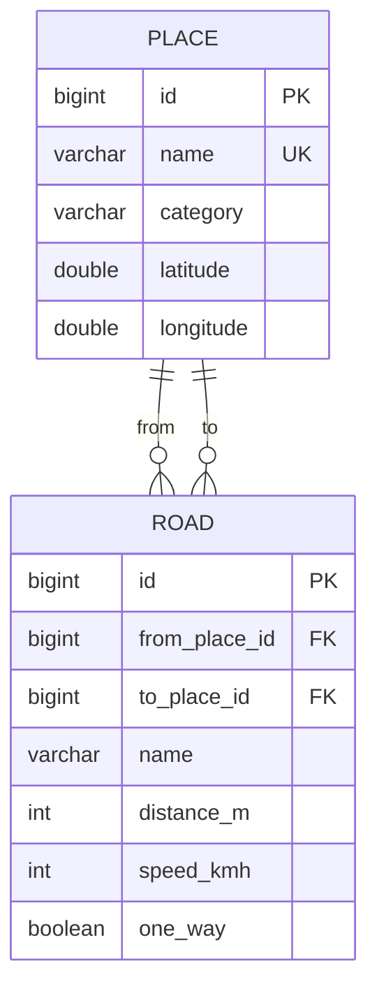

# Da Nang Route Finder

A Spring Boot REST API that finds routes on a road map of Da Nang stored in PostgreSQL. It implements the graph algorithms itself instead of calling a maps service: Dijkstra, A*, BFS, Yen's k-shortest paths, and an exact solver for the best order to visit several places (Held-Karp).

The seed data is 24 real places (airport, Dragon Bridge, My Khe beach, FPT University, Hoi An old town...) and 36 roads, one of them one-way.

```http
GET /api/routes?from=1&to=14&metric=TIME
```
```json
{
  "algorithm": "ASTAR",
  "metric": "TIME",
  "totalDistanceMeters": 15212,
  "totalSeconds": 1179,
  "nodesExpanded": 8,
  "places": [
    { "id": 1,  "name": "Sân bay Quốc tế Đà Nẵng", ... },
    { "id": 18, "name": "Lotte Mart Đà Nẵng", ... },
    { "id": 14, "name": "Đại học FPT Đà Nẵng", ... }
  ],
  "steps": [
    { "road": "Xô Viết Nghệ Tĩnh", "distanceMeters": 4670, "seconds": 420, ... },
    { "road": "Lê Văn Hiến", "distanceMeters": 10542, "seconds": 759, ... }
  ]
}
```

## Tech stack

Java 21 · Spring Boot 3.4 · Spring Data JPA (Hibernate 6) · PostgreSQL · Flyway · Bean Validation · springdoc OpenAPI · JUnit 5 + MockMvc · GitHub Actions (tests run on H2 **and** on PostgreSQL)

## API

| Method | Path | Description |
|---|---|---|
| GET | `/api/places?category=beach` | List places, optionally by category |
| GET | `/api/places/nearby?lat=&lon=&radiusMeters=&limit=` | Places within a radius, nearest first |
| POST | `/api/places` | Add a place |
| GET | `/api/roads` | List roads with both endpoints |
| POST | `/api/roads` | Add a road (two-way unless `oneWay`) |
| GET | `/api/routes?from=&to=&algorithm=ASTAR\|DIJKSTRA\|BFS&metric=DISTANCE\|TIME` | Best route |
| GET | `/api/routes/alternatives?from=&to=&k=3` | The k best loopless routes (Yen) |
| GET | `/api/routes/compare?from=&to=` | Same query with Dijkstra and A*: cost, nodes expanded, time |
| POST | `/api/tours` | Best order to visit up to 12 stops, optionally returning to the start |

Interactive docs: `http://localhost:8080/swagger-ui.html`. Errors use RFC 9457 problem details:
`{"status": 404, "detail": "No place with id 999"}`.

## Algorithms

All in `src/main/java/.../algo`, independent of Spring, and each one tested against a brute-force reference.

| Algorithm | Used for | Complexity | Tested against |
|---|---|---|---|
| Dijkstra (binary heap, lazy deletion) | shortest route | O((V + E) log V) | Bellman-Ford on 40 random graphs |
| A* | shortest route, faster | same worst case, fewer nodes in practice | Dijkstra: equal cost on every pair |
| BFS | fewest roads | O(V + E) | hand-built cases |
| Yen's k-shortest loopless paths | alternative routes | O(k · V · Dijkstra) | DFS enumeration of all simple paths |
| Held-Karp dynamic programming | visiting order of a tour (TSP) | O(2ⁿ · n²) | all n! permutations, n ≤ 7 |

**Why A\* stays exact.** A* orders the search by `cost so far + h(node)`, where `h` is a lower bound on the remaining cost. Here `h` is the straight-line (haversine) distance to the target, or that distance divided by the fastest speed limit when minimizing time. A lower bound is only valid if no road is shorter than the straight line between its ends, so `POST /api/roads` rejects such a road with `400`. With a valid bound A* returns the same cost as Dijkstra, which a test checks on every pair of nodes in random graphs.

**Tour planning.** `POST /api/tours` runs one Dijkstra from each stop to build a cost matrix, then Held-Karp: `best[S][j]` is the cheapest way to start at the origin, visit exactly the set `S`, and end at `j`. For 12 stops that is about 600 thousand steps, against 40 million orders by brute force.

## Database design



- The schema is versioned with **Flyway** (`db/migration/V1__schema.sql`, `V2__seed_da_nang.sql`); Hibernate never creates or changes tables (`ddl-auto: none`).
- **CHECK constraints** keep bad data out even if a bug slips past the API: coordinates in range, positive length, speed 5-120 km/h, no road from a place to itself.
- `UNIQUE (from_place_id, to_place_id)` prevents duplicate roads and doubles as the index for "roads leaving a place". PostgreSQL does not index foreign keys automatically, so `to_place_id` gets its own index for `ON DELETE CASCADE`.
- **Nearby search** uses a composite index on `(latitude, longitude)`. The query first selects a bounding box, which the index can answer, and only then computes the exact haversine distance for the few rows inside. `EXPLAIN` on PostgreSQL shows `Index Scan using idx_place_lat_lon`.
- The graph is built from a **JPQL constructor projection** (`select new RoadEdge(...)`), one query that reads only the needed columns instead of loading entities. The road list uses `join fetch` to avoid N+1 queries.

## Caching and concurrency

The graph is loaded into memory once and shared by all requests, so a route search does not touch the database. It is immutable: adding a place or a road marks the cache stale **after the transaction commits** (`TransactionSynchronization.afterCommit`), and the next request rebuilds it. Requests already running keep their old snapshot, so the read path needs no locks. The rebuild uses double-checked locking so only one thread rebuilds.

## Run it

```bash
# In-memory H2 database, no setup needed
mvn spring-boot:run

# With PostgreSQL
docker compose up -d
mvn spring-boot:run -Dspring-boot.run.profiles=postgres
```

Tests:

```bash
mvn test                                   # on H2
SPRING_DATASOURCE_URL=jdbc:postgresql://localhost:5432/routes \
SPRING_DATASOURCE_USERNAME=routes SPRING_DATASOURCE_PASSWORD=routes mvn test   # on PostgreSQL
```

## Limitations

- Coordinates are approximate and road lengths are estimated as 1.2-1.4x the straight-line distance.
- The whole graph lives in memory, which is fine for a city's main roads but not for a full OpenStreetMap extract.
- No traffic or time-of-day speeds.
